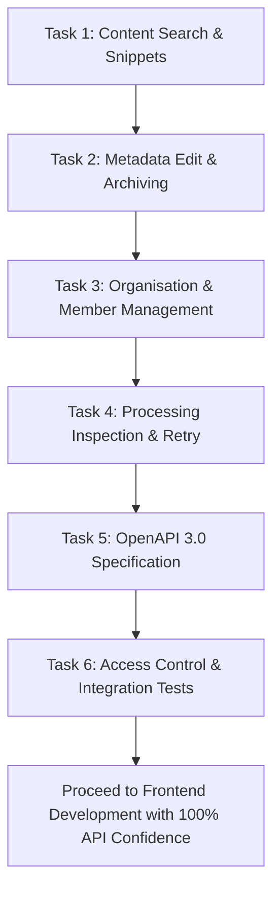

# AfriOps Backend Completion Roadmap (Pre-Frontend Checklist)

> **Document Status:** Active Implementation Guide  
> **Target:** Bring Backend from ~75% to 100% PRD MVP Compliance  
> **Prerequisite For:** Frontend Development (React + TypeScript)

---

## 1. Executive Summary & Readiness Assessment

The AfriOps backend currently has a strong foundation:
- **Authentication & Multi-Tenant Session**: JWT via HTTP-only cookie and Bearer header, password hashing, active organization context, and organization switching.
- **Document Ingestion & Storage**: Local storage abstraction with SHA-256 calculation, multipart upload validation, and file deletion.
- **Processing Pipeline**: Asynchronous background text extraction (TXT, PDF, DOCX), text chunking, and database storage.
- **AI Q&A (RAG)**: Chat conversations, message history, tenant-isolated passage retrieval, provider support (OpenAI, Gemini, fallback), and grounding source citations.
- **Dashboard**: Document counts by status (`queued`, `processing`, `completed`, `failed`) and recent upload summaries.

However, to satisfy the **AfriOps MVP Product Requirements Document (PRD)** and ensure the frontend team does not hit blocked or missing endpoints, **6 key tasks** remain to be completed.

---

## 2. Gap Analysis vs. PRD Requirements

| PRD Section | Requirement | Current Status | Blocker For Frontend? |
| :--- | :--- | :--- | :--- |
| **§1, §4.D, §6** | Document Content Search (searching inside chunk text, returning passage snippets) | **Incomplete**: Only searches `title` and `file_name` via `ILIKE`. | **Yes**: Document Search page won't find text within documents. |
| **§4.B, §6** | Metadata Editing, Archiving & Filtering | **Missing**: No edit/update endpoint, no archive state/endpoint, no status/mime filtering on list. | **Yes**: Document management table cannot filter, edit titles, or archive files. |
| **§4.A, §6** | Organisation & Membership Management | **Missing API Endpoints**: SQL queries exist, but no HTTP routes exist to list, invite, update roles, or remove members. | **Yes**: Team settings, member lists, and role management cannot be built. |
| **§4.C, §6** | Document Processing Status & Retry Handling | **Partially Missing**: No dedicated job inspection endpoint and no retry action for failed extractions. | **Medium**: Document details page cannot display job attempts or offer a "Retry" button. |
| **§6** | OpenAPI 3.0 Documentation | **Missing**: `backend/docs` is empty. | **Yes**: Frontend developers need a schema contract for types & SDK generation. |
| **§8, §9.8, §9.10**| Multi-Tenant Access Control & Workflow Tests | **Missing**: Only 4 basic unit tests exist. No cross-tenant isolation tests. | **Critical for security verification**. |

---

## 3. Detailed Implementation Tasks

### Task 1: Document Content Search & Snippet Retrieval
**PRD Reference:** Section 1, Section 4.D, Section 6, Section 9.6  
**Objective:** Enable users to search document contents across extractions/chunks and return relevant passage snippets grounded in the caller's organisation.

- [ ] **Endpoint:** `GET /api/v1/documents/search?q={query}&page={page}&page_size={page_size}`
- [ ] **Response Schema:**
  ```json
  {
    "success": true,
    "message": "Content search results retrieved",
    "data": [
      {
        "document_id": "uuid",
        "document_title": "Q3 Financials",
        "file_name": "q3_report.pdf",
        "chunk_id": "uuid",
        "chunk_index": 2,
        "page_number": 4,
        "snippet": "...revenue grew by 24% year-over-year in the West African market...",
        "relevance_score": 0.85
      }
    ],
    "pagination": { "page": 1, "page_size": 20, "total": 14 }
  }
  ```
- [ ] **Database & Query:**
  - Create `SearchChunksWithSnippets` in `internal/db/queries/extractions.sql` joining `document_chunks` with `documents` to return document details alongside the snippet.
- [ ] **Files to Touch:**
  - `backend/internal/db/queries/extractions.sql`
  - `backend/internal/modules/document/handler.go`
  - `backend/internal/modules/document/service.go`

---

### Task 2: Document Metadata Editing, Archiving & Filtering
**PRD Reference:** Section 4.B, Section 6  
**Objective:** Support metadata updates, archiving without hard deletion, and status/mime filtering on document lists.

- [ ] **Database Migration:**
  - Add `is_archived BOOLEAN NOT NULL DEFAULT FALSE` and `archived_at TIMESTAMPTZ` columns to `documents` table via a new Goose migration `00002_add_document_archiving.sql`.
- [ ] **Endpoints to Implement:**
  1. `PATCH /api/v1/documents/:id`
     - Allows updating `title` and custom key-value pairs (stored in `document_metadata`).
  2. `POST /api/v1/documents/:id/archive`
     - Sets `is_archived = true` and `archived_at = NOW()`.
  3. `POST /api/v1/documents/:id/unarchive`
     - Restores archived document.
  4. Enhance `GET /api/v1/documents`:
     - Support filter query parameters: `?status=completed&mime_type=application/pdf&is_archived=false`.
- [ ] **Files to Touch:**
  - `backend/internal/db/migrations/00002_add_document_archiving.sql`
  - `backend/internal/db/queries/documents.sql`
  - `backend/internal/modules/document/handler.go`
  - `backend/internal/modules/document/service.go`

---

### Task 3: Organisation & Membership Management API
**PRD Reference:** Section 4.A, Section 6  
**Objective:** Provide REST endpoints so users can manage team members, assign roles (`owner`, `admin`, `member`), and view active organisation details.

- [ ] **Module:** Create `internal/modules/organisation/` with `handler.go` and `service.go`.
- [ ] **Endpoints to Implement:**
  1. `GET /api/v1/organisations/current`
     - Returns active organisation profile, slug, member count, and creation date.
  2. `GET /api/v1/organisations/members`
     - Returns list of members with user details (`email`, `full_name`, `avatar_url`, `role`, `joined_at`).
  3. `POST /api/v1/organisations/members` *(Admin/Owner only)*
     - Add/invite user by email and assign role.
  4. `PATCH /api/v1/organisations/members/:user_id` *(Admin/Owner only)*
     - Update user's role (`owner`, `admin`, `member`).
  5. `DELETE /api/v1/organisations/members/:user_id` *(Admin/Owner only)*
     - Remove user from organisation (prevent removing the last owner).
- [ ] **Files to Touch:**
  - `backend/internal/modules/organisation/handler.go` (new)
  - `backend/internal/modules/organisation/service.go` (new)
  - `backend/cmd/api.go` (register routes)

---

### Task 4: Document Processing Status Inspection & Retry Endpoint
**PRD Reference:** Section 4.C, Section 6  
**Objective:** Allow clients to inspect extraction jobs and re-trigger processing for failed documents without duplicate jobs.

- [ ] **Endpoints to Implement:**
  1. `GET /api/v1/documents/:id/processing`
     - Returns processing job state, start/complete times, attempt count, extraction summary (words, pages, chunk count), and error message if failed.
  2. `POST /api/v1/documents/:id/retry`
     - Resets document status to `queued`, resets job attempts if under max limit, and re-triggers `processor.ProcessDocument` asynchronously.
- [ ] **Files to Touch:**
  - `backend/internal/modules/document/handler.go`
  - `backend/internal/modules/document/service.go`
  - `backend/internal/processor/service.go`

---

### Task 5: OpenAPI 3.0 API Specification
**PRD Reference:** Section 6  
**Objective:** Formalize all endpoints, models, request parameters, response schemas, and authentication cookies/headers in a standard OpenAPI 3.0 document.

- [ ] **File:** `backend/docs/openapi.yaml`
- [ ] **Covered Endpoint Groups:**
  - Auth (`/auth/register`, `/auth/login`, `/auth/logout`, `/auth/refresh`, `/auth/me`, `/auth/switch-org`)
  - Organisations & Members (`/organisations/current`, `/organisations/members`)
  - Documents (`/documents`, `/documents/upload`, `/documents/:id`, `/documents/:id/download`, `/documents/:id/archive`, `/documents/:id/processing`, `/documents/:id/retry`, `/documents/search`)
  - AI RAG (`/ai/conversations`, `/ai/conversations/:id/messages`, `/ai/conversations/:id/ask`)
  - Dashboard (`/dashboard/stats`)
  - Health check (`/health`, `/api/v1/health`)

---

### Task 6: Multi-Tenant Access Control & Integration Tests
**PRD Reference:** Section 8, Section 9.8, Section 9.10  
**Objective:** Enforce zero data leakage between organisations and verify critical API flows.

- [ ] **Test Scenarios to Cover:**
  1. **Cross-Tenant Document Isolation:**
     - User in Org A cannot view, download, update, or delete documents belonging to Org B (returns 404 or 403).
  2. **Cross-Tenant AI Context Isolation:**
     - Q&A in Org A cannot retrieve chunk passages or citations from Org B documents, even with identical search queries.
  3. **Role-Based Permissions (RBAC):**
     - Member role cannot delete documents or invite new owners/admins.
  4. **Document Ingestion & Processing Lifecycle:**
     - Upload document -> verify queued -> run processor -> verify completed -> verify extraction and chunks stored in database.
- [ ] **Files to Create:**
  - `backend/internal/modules/document/handler_test.go`
  - `backend/internal/modules/ai/service_test.go`
  - `backend/internal/middleware/auth_test.go`

---

## 4. Recommended Execution Order



### Next Step
Once these 6 tasks are completed, the backend will be **100% compliant with the PRD**, and the frontend can be built seamlessly against verified, documented endpoints.
